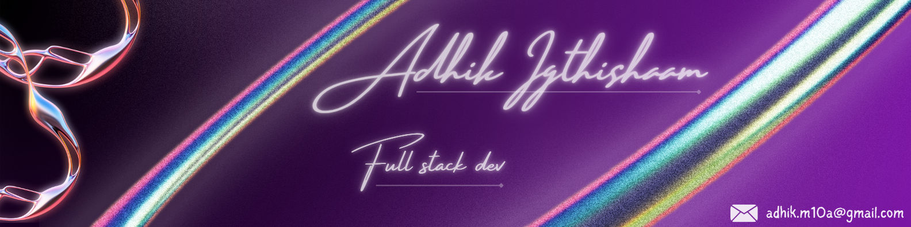

  

<h1 align="center">
  
</h1>

## 🧑🏻‍💻 About Me

- 🔭 I’m currently working on **SLM in mobile**
- 🌱 Exploring **Cloud Computing** and **Data Structures**
- 📱 Building offline-first mobile apps with React Native & Expo
- 🚀 Passionate about **turning ideas into scalable solutions**
- 💬 Ask me about **structuring real-world projects using Full stack**
- 💼 Open to internships and entry-level full-stack roles
- ⚡ Fun fact **I'm lazy but I never fail to meet deadlines**

 

## 🤝 Let's Connect

  
  
  

## 💻 Tech Stack
                                              

## 📊 GitHub Stats

  

  
  

### 🧮 Repository Traffic
<table>
  <tr>
    <td style="border: 2px solid #089CFF;">
      
    </td>
  </tr>
</table>

<!-- ### 🏆 Achievements
 -->

## 📌 Top projects

  

## 🎮 Contribution Graph

<picture>
  <source media="(prefers-color-scheme: dark)" srcset="https://raw.githubusercontent.com/Adhik-6/Adhik-6/output/pacman-contribution-graph-dark.svg">
  <source media="(prefers-color-scheme: light)" srcset="https://raw.githubusercontent.com/Adhik-6/Adhik-6/output/pacman-contribution-graph.svg">
  
</picture>

## 🫱🏼‍🫲🏻 Support

  

 

<!-- Footer -->
